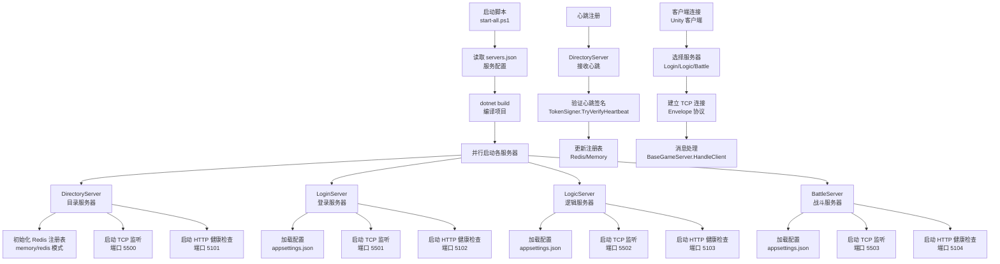
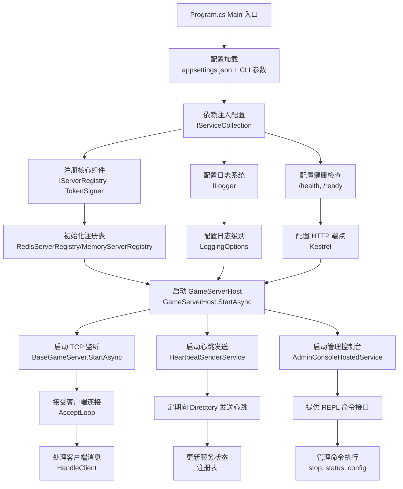
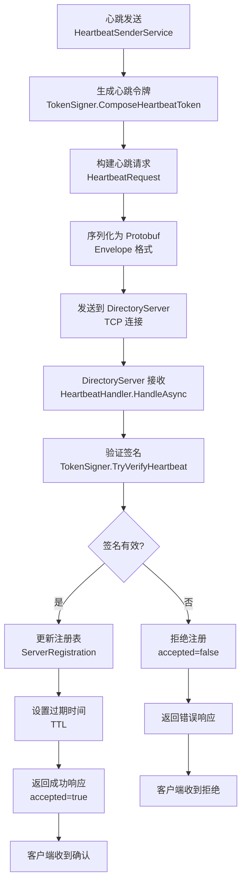
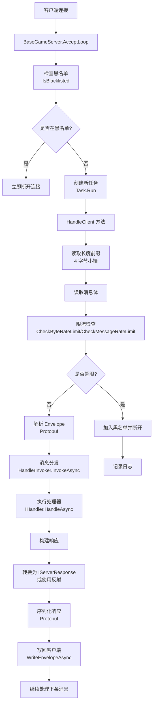
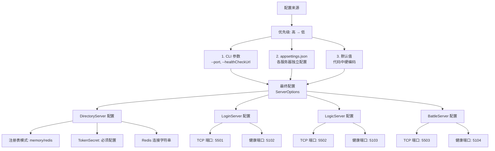
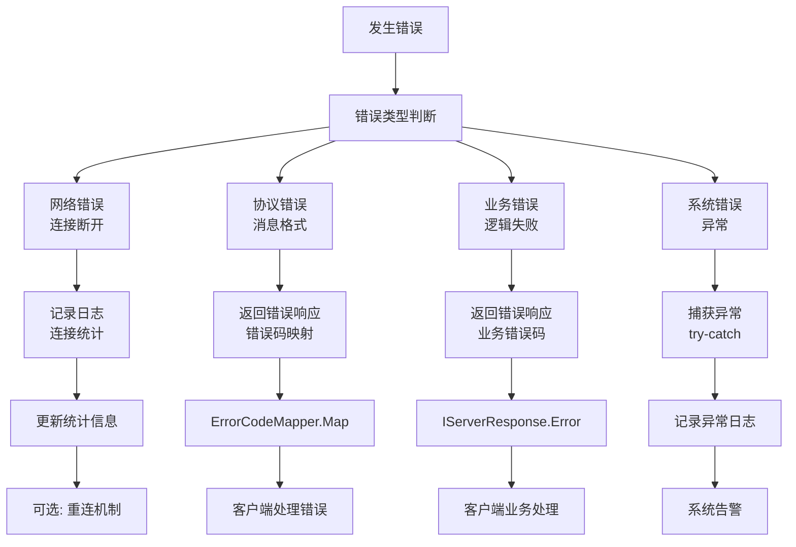
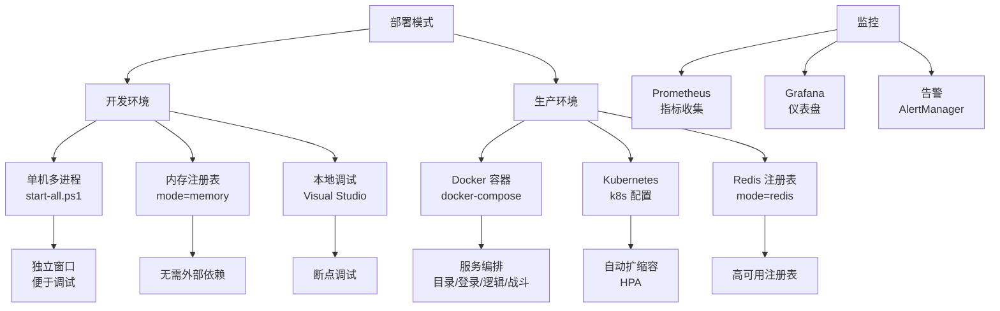

# DotNetGameServer 启动流程图

## 整体启动流程



## 单服务器启动详细流程



## 心跳注册流程



## 客户端连接处理流程



## 配置加载优先级



## 健康检查与监控

```mermaid
flowchart TD
    A[健康检查端点] --> B[Kestrel HTTP 服务器]
    
    B --> C[/health<br>Liveness 检查]
    B --> D[/ready<br>Readiness 检查]
    B --> E[/api/routing/query<br>路由查询]
    B --> F[/admin/command<br>管理命令]
    
    C --> G[检查进程状态<br>是否存活]
    D --> H[检查服务就绪<br>依赖项]
    E --> I[查询注册表<br>可用服务器]
    F --> J[执行管理命令<br>REPL]
    
    G --> K[返回 200 OK<br>或 503]
    H --> L[返回 200 OK<br>或 503]
    I --> M[JSON 响应<br>服务器列表]
    J --> N[命令执行结果]
    
    O[监控系统] --> P[定期轮询 /health]
    O --> Q[定期轮询 /ready]
    O --> R[查询路由信息]
    
    P --> S[告警触发<br>服务宕机]
    Q --> T[流量切换<br>服务未就绪]
    R --> U[负载均衡<br>选择服务器]
```

## 错误处理流程



## 部署模式



## 关键配置项

| 配置项 | 默认值 | 说明 | 环境 |
|--------|--------|------|------|
| `server:port` | 5500-5503 | TCP 监听端口 | 所有 |
| `server:healthCheckUrl` | http://localhost:5101-5104 | 健康检查 URL | 所有 |
| `directory:registry:mode` | memory | 注册表模式: memory/redis | Directory |
| `directory:tokenSecret` | (必须配置) | 令牌签名密钥 | Directory |
| `logging:level` | Information | 日志级别 | 所有 |
| `heartbeat:intervalSeconds` | 30 | 心跳间隔秒数 | 所有 |
| `redis:connectionString` | localhost:6379 | Redis 连接 | Directory |
| `redis:ssl` | false | 启用 SSL | Directory |
| `redis:sslHost` | (可选) | SSL 主机名 | Directory |
| `redis:clientCertificate` | (可选) | 客户端证书 | Directory |
