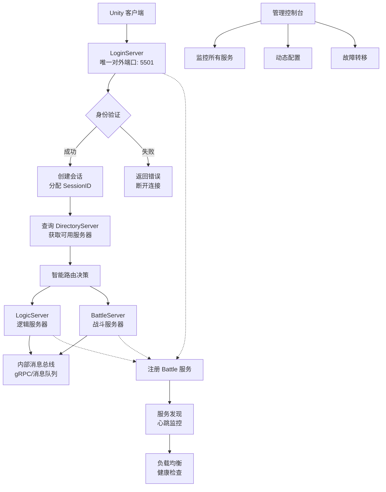
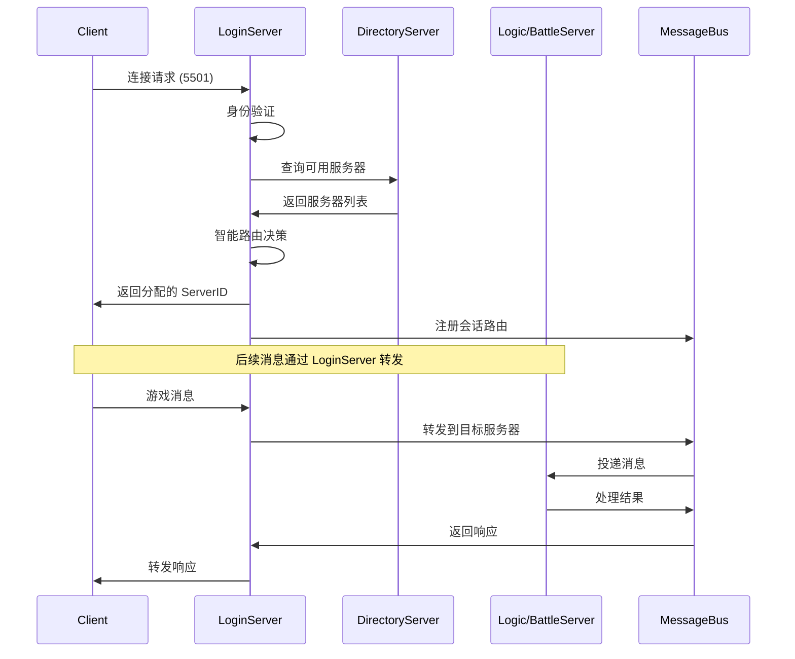

# DotNetGameServer 架构优化方案

## 当前架构问题

### 1. 暴露过多端口
- **DirectoryServer**: 端口 5500 (TCP) + 5101 (HTTP)
- **LoginServer**: 端口 5501 (TCP) + 5102 (HTTP)  
- **LogicServer**: 端口 5502 (TCP) + 5103 (HTTP)
- **BattleServer**: 端口 5503 (TCP) + 5104 (HTTP)

**问题**: 客户端需要知道所有服务器地址，且可以直接连接 Logic/Battle 服务器，绕过登录验证。

### 2. 缺乏智能分流
- 客户端连接 LoginServer 后，需要手动选择 Logic/Battle 服务器
- 没有负载均衡和智能路由机制
- 服务器间通信缺乏统一的消息总线

## 优化目标

1. **单一入口**: 只有 LoginServer 对外暴露 TCP 端口
2. **内部通信**: Directory/Logic/Battle 作为内部服务，不直接对外
3. **智能路由**: LoginServer 根据业务逻辑智能分配连接
4. **服务发现**: 通过 DirectoryServer 实现服务注册与发现
5. **消息总线**: 服务器间通过统一的消息通道通信

## 新架构设计



## 具体实现方案

### 1. 端口调整

| 服务器 | 当前端口 | 优化后端口 | 说明 |
|--------|----------|------------|------|
| **LoginServer** | 5501 (TCP)<br>5102 (HTTP) | **5501 (TCP)**<br>5102 (HTTP) | **唯一对外端口** |
| **DirectoryServer** | 5500 (TCP)<br>5101 (HTTP) | **内部服务**<br>5101 (HTTP) | 仅 HTTP 管理接口 |
| **LogicServer** | 5502 (TCP)<br>5103 (HTTP) | **内部服务**<br>5103 (HTTP) | 仅通过消息总线通信 |
| **BattleServer** | 5503 (TCP)<br>5104 (HTTP) | **内部服务**<br>5104 (HTTP) | 仅通过消息总线通信 |

### 2. LoginServer 增强功能

```csharp
// 新增 LoginServer 路由管理器
public class LoginRouter
{
    private readonly IServerRegistry _registry;
    private readonly IMessageBus _messageBus;
    
    // 智能路由决策
    public ServerRegistration RouteClient(ClientSession session)
    {
        // 1. 根据玩家等级/区域选择 LogicServer
        // 2. 根据战斗类型选择 BattleServer
        // 3. 基于负载均衡算法
        // 4. 考虑服务器亲和性（同一玩家尽量分配到同一服务器）
    }
    
    // 消息转发
    public async Task ForwardMessage(string sessionId, byte[] message)
    {
        var targetServer = GetTargetServer(sessionId);
        await _messageBus.SendAsync(targetServer, message);
    }
}
```

### 3. 内部消息总线设计

```csharp
// 消息总线接口
public interface IMessageBus
{
    Task SendAsync(string serverId, byte[] message);
    Task BroadcastAsync(MessageType type, byte[] message);
    IAsyncEnumerable<Message> SubscribeAsync(string serverId);
}

// 实现选项：
// 1. gRPC 流式通信
// 2. Redis Pub/Sub
// 3. RabbitMQ/Kafka
// 4. 内存通道（单机部署）
```

### 4. 服务注册增强

```csharp
// 增强 ServerRegistration 信息
public class EnhancedServerRegistration : ServerRegistration
{
    public ServerType Type { get; set; } // Login/Logic/Battle
    public Dictionary<string, string> Metadata { get; set; } // 区域、版本、容量等
    public LoadMetrics Load { get; set; } // CPU、内存、连接数
    public List<string> SupportedFeatures { get; set; } // 支持的功能
}

// 服务类型枚举
public enum ServerType
{
    Directory, // 目录服务
    Login,     // 登录门户
    Logic,     // 逻辑处理
    Battle,    // 战斗处理
    Chat,      // 聊天服务（可扩展）
    Match,     // 匹配服务（可扩展）
}
```

### 5. 客户端连接流程优化



## 实施步骤

### Phase 1: 基础架构改造 (1-2周)

1. **隐藏内部服务器端口**
   - 修改 `scripts/servers.json`，只暴露 LoginServer 端口
   - 调整防火墙/网络策略
   - 更新部署文档

2. **增强 DirectoryServer 注册信息**
   - 添加服务器类型字段
   - 增加负载指标收集
   - 完善健康检查

3. **实现基础消息总线**
   - 选择实现方案（推荐 Redis Pub/Sub）
   - 定义消息协议格式
   - 实现基本发送/接收功能

### Phase 2: LoginServer 路由功能 (2-3周)

4. **实现 LoginRouter**
   - 智能路由算法
   - 会话管理
   - 消息转发

5. **客户端 SDK 更新**
   - 简化连接流程
   - 自动重连机制
   - 错误处理优化

### Phase 3: 高级功能 (3-4周)

6. **负载均衡与弹性伸缩**
   - 基于指标的自动扩缩容
   - 故障自动转移
   - 灰度发布支持

7. **监控与运维**
   - 完善指标收集
   - 告警规则配置
   - 运维控制台增强

## 技术选型建议

### 消息总线方案对比

| 方案 | 优点 | 缺点 | 适用场景 |
|------|------|------|----------|
| **Redis Pub/Sub** | 简单、快速、已有依赖 | 无持久化、无确认机制 | 中小规模、实时性要求高 |
| **gRPC 流** | 高性能、强类型、双向流 | 点对点、无广播 | 服务器间直接通信 |
| **RabbitMQ** | 功能丰富、可靠、有持久化 | 较重、需要额外部署 | 大规模、需要可靠投递 |
| **内存通道** | 零延迟、无网络开销 | 单机限制、无容错 | 开发测试、单机部署 |

**推荐**: 初期使用 **Redis Pub/Sub**（已有依赖），后期可扩展为 **混合模式**（Redis + gRPC）。

### 负载均衡算法

```csharp
public enum LoadBalanceAlgorithm
{
    RoundRobin,     // 轮询
    LeastConnections, // 最少连接
    WeightedRoundRobin, // 加权轮询
    LeastResponseTime,  // 最快响应
    ConsistentHash,     // 一致性哈希（会话亲和）
    Custom,             // 自定义规则
}
```

## 配置变更

### 新的 servers.json 结构

```json
{
  "servers": [
    {
      "name": "Login",
      "type": "login",
      "project": "src/Servers/LoginServer/LoginServer.csproj",
      "port": 5501,
      "healthPort": 5102,
      "public": true,
      "maxConnections": 10000
    },
    {
      "name": "Directory",
      "type": "directory", 
      "project": "src/Servers/DirectoryServer/DirectoryServer.csproj",
      "port": 5500,
      "healthPort": 5101,
      "public": false,
      "maxConnections": 100
    },
    {
      "name": "Logic-1",
      "type": "logic",
      "project": "src/Servers/LogicServer/LogicServer.csproj",
      "port": 0, // 动态分配或内部端口
      "healthPort": 5103,
      "public": false,
      "capacity": 5000,
      "region": "cn-east"
    },
    {
      "name": "Battle-1",
      "type": "battle",
      "project": "src/Servers/BattleServer/BattleServer.csproj",
      "port": 0, // 动态分配或内部端口
      "healthPort": 5104,
      "public": false,
      "capacity": 1000,
      "gameTypes": ["pvp", "pve"]
    }
  ]
}
```

## 安全考虑

1. **网络隔离**
   - 内部服务器使用私有网络
   - 只有 LoginServer 在 DMZ 区域
   - 内部通信加密（mTLS）

2. **访问控制**
   - 内部服务间相互认证
   - 基于角色的访问控制
   - 请求签名验证

3. **审计日志**
   - 所有路由决策记录
   - 消息转发跟踪
   - 异常行为检测

## 性能影响评估

### 正面影响
- **减少客户端连接数**: 从连接多个服务器变为只连一个
- **集中式管理**: 便于监控和限流
- **弹性伸缩**: 可以动态增减 Logic/Battle 服务器

### 负面影响
- **单点瓶颈**: LoginServer 成为性能瓶颈
- **额外延迟**: 消息转发增加一跳延迟
- **复杂度增加**: 需要维护路由状态

### 缓解措施
- **LoginServer 集群**: 多实例负载均衡
- **连接持久化**: 减少握手开销
- **消息批处理**: 降低转发频率

## 迁移策略

1. **兼容模式**: 支持新旧客户端同时连接
2. **渐进迁移**: 按功能模块逐步切换
3. **回滚方案**: 随时可以切回旧架构
4. **监控指标**: 对比新旧架构性能数据

## 总结

优化后的架构更符合微服务设计原则：
- **单一职责**: 每个服务器职责更清晰
- **松耦合**: 通过消息总线解耦
- **可扩展**: 方便水平扩展
- **易维护**: 集中式管理和监控

建议按阶段实施，每阶段完成后进行充分测试和性能评估。
