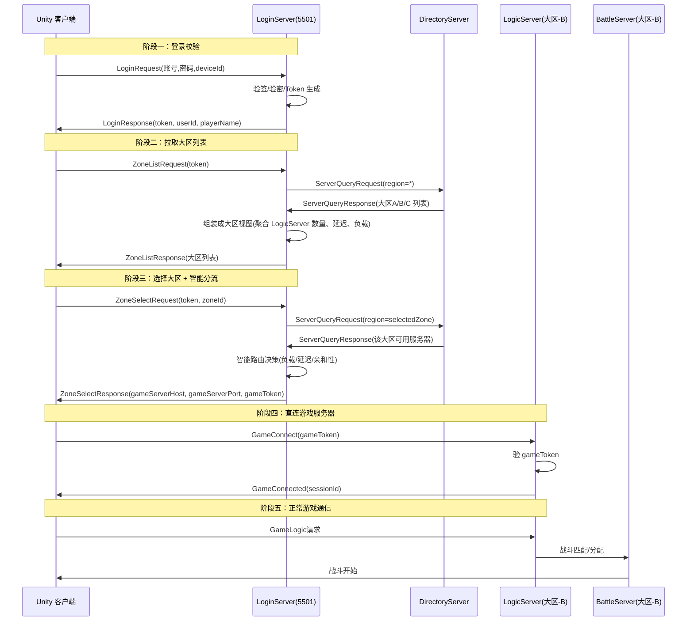
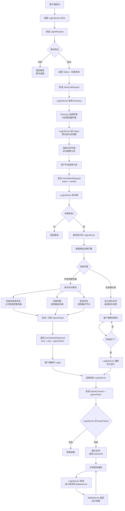

# 登录校验 → 大区选择 → 智能分流 流程设计

## 整体时序图



## Proto 协议定义

### 新增消息类型：`src/Shared/Protos/login.proto`

```protobuf
syntax = "proto3";
package DotNetGameServer;

// ========== 阶段一：登录校验 ==========
message LoginRequest {
    string account = 1;          // 账号
    string password_hash = 2;    // 密码哈希（客户端先做一次 Hash）
    string device_id = 3;        // 设备唯一标识
    string client_version = 4;   // 客户端版本
    string platform = 5;         // 平台：ios/android/windows
}

message LoginResponse {
    bool success = 1;
    int32 error_code = 2;        // 0=成功
    string error_message = 3;
    string token = 4;            // 登录令牌（后续请求携带）
    int64 token_expire_at = 5;   // 令牌过期时间(unix秒)
    string user_id = 6;
    string player_name = 7;
    int32 player_level = 8;
    bool is_new_player = 9;
    // 公告/维护信息
    string announcement = 10;
    bool under_maintenance = 11;
    string maintenance_end_at = 12;
}

// ========== 阶段二：拉取大区列表 ==========
message ZoneListRequest {
    string token = 1;            // 登录令牌
}

message ZoneInfo {
    string zone_id = 1;          // 大区ID，如 "cn-east-1"
    string zone_name = 2;        // 大区名称，如 "华东一区"
    string zone_desc = 3;        // 大区描述
    int32 player_count = 4;      // 该大区在线人数
    int32 server_count = 5;      // 该大区可用服务器数
    string load_status = 6;      // 负载状态：low/medium/high/full/maintenance
    int32 avg_ping_ms = 7;       // 平均延迟(ms)，0=未测
    bool is_recommended = 8;     // 是否推荐大区
    bool is_new = 9;             // 是否新区
    string version = 10;         // 大区游戏版本
    repeated ZoneLabel labels = 11;  // 标签
}

message ZoneLabel {
    string key = 1;              // 标签键，如 "type"
    string value = 2;            // 标签值，如 "pvp"/"pve"/"beginner"
}

message ZoneListResponse {
    bool success = 1;
    int32 error_code = 2;
    string error_message = 3;
    repeated ZoneInfo zones = 4; // 大区列表
    int64 server_time = 5;       // 服务器时间(unix秒)
    ZoneInfo recommended_zone = 6; // 推荐大区
}

// ========== 阶段三：选择大区 + 智能分流 ==========
message ZoneSelectRequest {
    string token = 1;            // 登录令牌
    string zone_id = 2;          // 选择的大区ID
    int32 client_ping_ms = 3;    // 客户端到Login的延迟(ms)
}

message ZoneSelectResponse {
    bool success = 1;
    int32 error_code = 2;
    string error_message = 3;
    string game_server_host = 4;  // 分配的LogicServer 地址
    int32 game_server_port = 5;   // 分配的LogicServer 端口
    string game_token = 6;        // 游戏连接令牌(一次性)
    int64 game_token_expire_at = 7; // 游戏令牌过期(unix秒)
    string zone_name = 8;         // 大区名称
    int32 queue_position = 9;     // 排队位置(0=无需排队)
    int32 queue_eta_seconds = 10; // 预计排队时间(秒)
}
```

## LoginServer 核心实现

### `src/Servers/LoginServer/LoginHandler.cs`

```csharp
using Core;
using DotNetGameServer;
using Google.Protobuf;
using Core.Directory;

namespace LoginServer;

public class LoginHandler
{
    private readonly IServerRegistry _registry;
    private readonly ServerSelectionStrategyFactory _strategyFactory;
    private readonly TokenSigner _tokenSigner;

    /// <summary>
    /// 阶段一：登录校验。
    /// 验证账号密码，生成登录令牌，返回玩家信息。
    /// </summary>
    public async Task<LoginResponse> HandleLoginAsync(LoginRequest request)
    {
        // 1. 版本检查
        if (!IsVersionSupported(request.ClientVersion))
            return new LoginResponse { Success = false, ErrorCode = 1001, ErrorMessage = "客户端版本过旧，请更新" };

        // 2. 账号验证（对接账号系统/数据库）
        var authResult = await AuthenticateAsync(request.Account, request.PasswordHash, request.DeviceId);
        if (!authResult.Success)
            return new LoginResponse { Success = false, ErrorCode = 1002, ErrorMessage = authResult.ErrorMessage };

        // 3. 生成登录令牌
        var tokenId = Guid.NewGuid().ToString("N");
        var expireAt = DateTimeOffset.UtcNow.AddHours(2).ToUnixTimeSeconds();
        var token = TokenSigner.ComposeSigned(tokenId, expireAt, TokenSigner.ComputeSignature(
            tokenId, expireAt, authResult.UserId, request.DeviceId, _tokenSecret));

        // 4. 返回结果
        return new LoginResponse
        {
            Success = true,
            Token = token,
            TokenExpireAt = expireAt,
            UserId = authResult.UserId,
            PlayerName = authResult.PlayerName,
            PlayerLevel = authResult.PlayerLevel,
            IsNewPlayer = authResult.IsNewPlayer,
            Announcement = GetAnnouncement(),
            UnderMaintenance = false
        };
    }

    /// <summary>
    /// 阶段二：拉取大区列表。
    /// 从 DirectoryServer 获取所有注册的大区，按负载和延迟排序。
    /// </summary>
    public async Task<ZoneListResponse> HandleZoneListAsync(ZoneListRequest request)
    {
        // 1. 验登录令牌
        if (!TryVerifyToken(request.Token, out var userId))
            return new ZoneListResponse { Success = false, ErrorCode = 2001, ErrorMessage = "令牌无效或已过期" };

        // 2. 从注册表获取所有在线服务器
        var allServers = await _registry.GetAllAsync();

        // 3. 按 region 分组 → 每个 region 就是一个大区
        var zones = allServers
            .GroupBy(s => s.Region)
            .Select(g => BuildZoneInfo(g.Key, g.ToList()))
            .OrderByDescending(z => z.IsRecommended)
            .ThenBy(z => z.ZoneName)
            .ToList();

        // 4. 推荐大区：客户端延迟最低或有好友在线的
        var recommended = zones.OrderBy(z => z.AvgPingMs).FirstOrDefault();

        return new ZoneListResponse
        {
            Success = true,
            Zones = { zones },
            ServerTime = DateTimeOffset.UtcNow.ToUnixTimeSeconds(),
            RecommendedZone = recommended
        };
    }

    /// <summary>
    /// 阶段三：选择大区 + 智能分流。
    /// 根据大区ID找到该大区内所有可用 LogicServer，
    /// 使用智能路由算法选择最优服务器，生成一次性游戏令牌。
    /// </summary>
    public async Task<ZoneSelectResponse> HandleZoneSelectAsync(ZoneSelectRequest request)
    {
        // 1. 验登录令牌
        if (!TryVerifyToken(request.Token, out var userId))
            return new ZoneSelectResponse { Success = false, ErrorCode = 2001, ErrorMessage = "令牌无效或已过期" };

        // 2. 查询该大区的 LogicServer 列表
        var query = new ServerQueryRequest
        {
            ServerType = "logic",
            Region = request.ZoneId,
            Strategy = "load",   // 按负载优先
            Limit = 10
        };
        var servers = await _registry.QueryAsync(query);

        if (servers.Count == 0)
            return new ZoneSelectResponse { Success = false, ErrorCode = 3001, ErrorMessage = "该大区暂无可用服务器" };

        // 3. 智能路由决策
        var selected = SelectBestServer(servers, userId, request.ClientPingMs);

        // 4. 生成一次性游戏令牌
        var gameToken = GenerateGameToken(userId, selected.ServerId);

        // 5. 排队机制（如果目标服已满）
        if (selected.PlayerCount >= selected.Capacity)
        {
            var queueInfo = await EnqueueAsync(userId, selected.ServerId);
            return new ZoneSelectResponse
            {
                Success = true,
                QueuePosition = queueInfo.Position,
                QueueEtaSeconds = queueInfo.EtaSeconds
            };
        }

        return new ZoneSelectResponse
        {
            Success = true,
            GameServerHost = selected.Host,
            GameServerPort = selected.Port,
            GameToken = gameToken,
            GameTokenExpireAt = DateTimeOffset.UtcNow.AddMinutes(5).ToUnixTimeSeconds(),
            ZoneName = $"{selected.Region} - {selected.ServerId}"
        };
    }

    /// <summary>
    /// 智能路由：综合负载、延迟、玩家亲和性选择最优服务器。
    /// </summary>
    private ServerInfo SelectBestServer(List<ServerInfo> servers, string userId, int clientPing)
    {
        // 1. 过滤掉满负荷和维护中的
        var available = servers
            .Where(s => s.Status == "online" 
                     && s.PlayerCount < s.Capacity 
                     && s.Load < 0.9f)
            .ToList();

        if (available.Count == 0)
            available = servers; // 没得选，全部候选

        // 2. 检查玩家亲和性（上次登录的服务器）
        var lastServer = GetLastLoginServer(userId);
        var affinityServer = available.FirstOrDefault(s => s.ServerId == lastServer);
        if (affinityServer != null && affinityServer.Load < 0.8f)
            return affinityServer; // 优先回原来的服

        // 3. 综合评分 = 负载权重(50%) + 容量权重(20%) + 延迟权重(20%) + 随机(10%)
        var scored = available.Select(s =>
        {
            var loadScore = 1.0f - s.Load;                          // 负载越低分越高
            var capacityScore = 1.0f - (float)s.PlayerCount / s.Capacity;
            var latencyScore = clientPing > 0 ? 1.0f - Math.Min(clientPing / 500f, 1f) : 0.5f;
            var randomFactor = Random.Shared.NextSingle() * 0.1f;

            return new { Server = s, Score = loadScore * 0.5f + capacityScore * 0.2f + latencyScore * 0.2f + randomFactor };
        });

        return scored.OrderByDescending(x => x.Score).First().Server;
    }
}
```

## 大区数据结构

### 基于现有 HeartbeatRequest 的扩展

现有 `HeartbeatRequest` 已有 `region` 字段，可直接用作大区标识。每个 LogicServer 启动时向 Directory 注册时带上 region 信息，LoginServer 查询时按 region 聚合即可。

**大区划分示例**：

| 大区ID | 名称 | region | LogicServer 实例数 |
|--------|------|--------|-------------------|
| cn-east-1 | 华东一区(上海) | cn-east-1 | 3（Logic-1, Logic-2, Logic-3） |
| cn-east-2 | 华东二区(杭州) | cn-east-2 | 2 |
| cn-south-1 | 华南一区(广州) | cn-south-1 | 3 |
| cn-north-1 | 华北一区(北京) | cn-north-1 | 2 |
| cn-west-1 | 西南一区(成都) | cn-west-1 | 1 |

### 已有字段直接可用

```csharp
// HeartbeatRequest 中已有的字段完美匹配：
message HeartbeatRequest {
    string server_id = 1;    // "logic-cn-east-1-01"
    string server_type = 2;  // "logic" / "battle"
    string host = 3;         // 内网或公网地址
    int32 port = 4;          // 监听端口
    int32 player_count = 5;  // 当前在线数
    int32 capacity = 6;      // 最大容量
    string region = 7;       // "cn-east-1" ← 这就是大区ID
    string version = 8;      // 游戏版本
}
```

## 完整流程图



## 智能路由决策引擎详解

```mermaid
flowchart TD
    A[ZoneSelectRequest 到达] --> B[获取候选服务器列表]
    
    B --> C[第一层过滤]
    C --> D{status == online?}
    C --> E{load < 0.9?}
    C --> F{playerCount < capacity?}
    
    D --> G[可用服务器池]
    E --> G
    F --> G
    
    G --> H{启用亲和性?}
    H -->|是| I[查询玩家上次登录<br>的服务器ID]
    I --> J{该服务器负载 < 80%?}
    J -->|是| K[直接返回该服务器<br>权重: 100%]
    J -->|否| L[进入多维度评分]
    
    H -->|否| L
    
    L --> M[维度一: 负载得分 50%<br>得分 = 1 - load]
    L --> N[维度二: 容量得分 20%<br>得分 = 1 - playerCount/capacity]
    L --> O[维度三: 延迟得分 20%<br>得分 = 1 - min(ping/500, 1)]
    L --> P[维度四: 随机因子 10%<br>避免所有请求打向同一台]
    
    M --> Q[综合得分汇总]
    N --> Q
    O --> Q
    P --> Q
    
    Q --> R[按得分降序排列]
    R --> S[返回最优服务器]
```

### 评分公式

```
综合得分 = 负载得分 × 0.5 + 容量得分 × 0.2 + 延迟得分 × 0.2 + 随机因子 × 0.1
```

| 因素 | 权重 | 说明 |
|------|------|------|
| 负载 | 50% | 优先选低负载服务器，避免热点 |
| 容量 | 20% | 优先选空闲容量大的服务器 |
| 延迟 | 20% | 优先选网络延迟低的服务器 |
| 随机 | 10% | 打散流量，避免羊群效应 |

### 特殊规则

| 规则 | 触发条件 | 行为 |
|------|----------|------|
| **好友同服** | 玩家好友列表中 >= 3 人在某大区 | 推荐该大区，标记"好友在玩" |
| **回归优先** | 玩家超过 7 天未登录 | 优先分配历史服务器（亲和性） |
| **新手保护** | 玩家等级 <= 10 | 分配到新手专区或低压力服 |
| **段位匹配** | 竞技类游戏 | 优先分配到相近段位的玩家所在服 |
| **新服引流** | 新开大区 < 7 天 | 推荐列表中置顶，标注"NEW" |

## 实现清单

### Phase 1：协议定义（1天）
- [ ] 新增 `src/Shared/Protos/login.proto`
- [ ] 生成对应的 C# 代码

### Phase 2：LoginServer 改造（3-5天）
- [ ] 实现 `LoginHandler`（登录/大区列表/大区选择）
- [ ] 实现 `SmartRouter`（智能路由引擎）
- [ ] 实现 `QueueManager`（排队机制）
- [ ] 实现 `GameTokenGenerator`（一次性游戏令牌）
- [ ] 注册 Handler 到 `BaseGameServer`

### Phase 3：DirectoryServer 增强（2-3天）
- [ ] 增强 `ServerQueryHandler`，支持按 region + type 联合查询
- [ ] 添加大区级聚合查询接口
- [ ] 增加在线人数统计

### Phase 4：客户端对接（3-5天）
- [ ] 实现登录流程 UI（账号密码 → Token 缓存）
- [ ] 实现大区列表 UI（推荐大区高亮、负载状态标识）
- [ ] 实现大区选择 → 智能分流 → 直连 LogicServer
- [ ] 实现断线重连（Token 续期、GameToken 重新申请）

### Phase 5：测试与压测（2-3天）
- [ ] 单元测试（LoginHandler、SmartRouter）
- [ ] 集成测试（完整登录 → 大区选择 → 直连流程）
- [ ] 压力测试（模拟万人同时登录 + 选择大区）

## 大区列表UI 示意

客户端收到 `ZoneListResponse` 后的渲染：

| 大区名称 | 状态 | 在线人数 | 延迟 | 标签 |
|----------|------|----------|------|------|
| **华东一区(上海)** ★推荐 | 🟢 流畅 | 13,245 | 12ms | PVP |
| 华东二区(杭州) | 🟢 流畅 | 8,921 | 18ms | PVE |
| 华南一区(广州) | 🟡 繁忙 | 45,321 | 35ms | - |
| 华北一区(北京) | 🟠 拥挤 | 78,234 | 50ms | - |
| 西南一区(成都) NEW | 🟢 流畅 | 2,134 | 62ms | 新区 |
| 海外-东南亚 | 🔴 维护中 | - | - | 维护 |

## 总结

此方案的核心优势：

1. **用户体验流畅**：登录 → 选大区 → 自动分配 → 直连，流程清晰
2. **服务端可控**：所有路由决策在服务端，客户端零感知
3. **架构友好**：LoginServer 只负责入口逻辑，业务流量直连后端，延迟低
4. **可扩展**：新增大区只需部署新 LogicServer 并向 Directory 注册
5. **基于现有设施**：复用 Envelope 协议、TokenSigner、Directory 注册表等